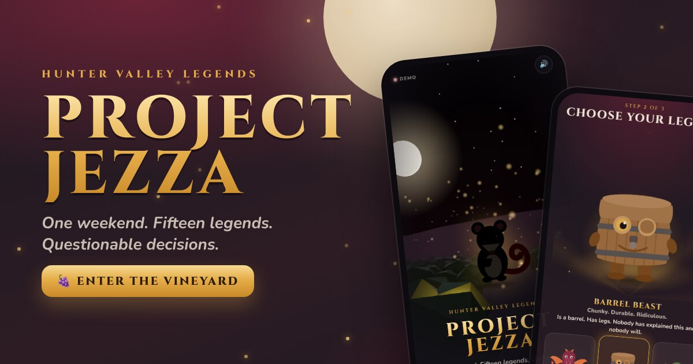
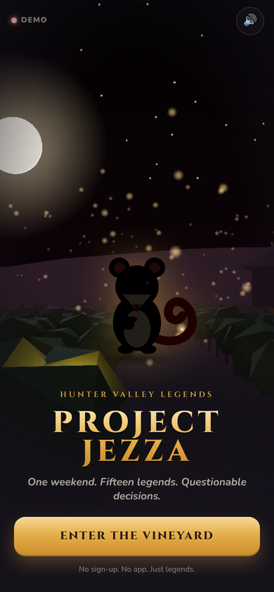

# PROJECT JEZZA: HUNTER VALLEY LEGENDS

A mobile-first, real-time multiplayer party game for Jezza's bucks weekend in the Hunter Valley.
Mates join a shared vineyard from their phone browser, adopt an original creature, complete ridiculous
missions, battle each other, and compete for weekend glory across Friday and Saturday.





More screenshots at every tested viewport live in [`docs/screenshots/`](docs/screenshots/)
(320×568, 360×640, 390×844, 412×915, plus `live/` from a real two-browser session).

---

## What's in the box

| Area | Status |
| --- | --- |
| Cinematic Three.js opening (moonlit vineyard, fog, gold particles, cellar) with CSS/SVG fallback | ✅ |
| 30-second onboarding: enter → nickname (code comes from the share link) → creature → reveal → first challenge | ✅ |
| **Runs itself, no host needed**: Friday starts on creation, Saturday at 5am Sydney, group challenges every 40 min | ✅ |
| 85 quick challenges in Aussie English (make Jezza laugh, dance, sing, cooked photos, get Jezza in, cheers, sneaky, low-key, group) | ✅ |
| Self-service checks: honour system (8-min cooldown), photo (instant), a mate confirms. 🚩 Call BS, settled by the lads or the host | ✅ |
| Low-key mode: no performing challenges for anyone who'd rather not | ✅ |
| Boss raids on Friday (Bin Chicken King) and Saturday (Hangover Hydra): 15 min, loot for everyone who swings | ✅ |
| Evolutions at Lv4 and Lv8, max one on Friday, teased ahead ("twitching…", mystery silhouette), full reveal animation | ✅ |
| Saturday arrivals: Fresh Legs (2× points on first 6 challenges, 2× XP until caught up) | ✅ |
| Battles: Attack / Counter / Special + power tap, ranked ladder, win streaks, bounty on the leader | ✅ |
| The Jezza Wall (roasts and toasts, votes, Jezza's ❤️, Roast Reel at the finale) | ✅ |
| The Cellar: drink reviews with label photos (any drink counts; only 3 a day score) | ✅ |
| 😂 🔥 reactions (❤️ for Jezza only) that drive the awards | ✅ |
| Party camera roll; anyone can take a photo down | ✅ |
| 11 data-driven awards + live "Award race" tab; finale reveal | ✅ |
| Host PIN, leave/new room, join-by-link, link previews, persistence, keepsake photo export | ✅ |

Deliberately **not** built: Wine Snob Championship, Mr & Mrs Hot Seat, Jezza Bingo, video uploads
(a mate confirming covers dances and songs, and video would be heavy on phones and the server).

## Try it right now (no install)

**https://travex-pixel.github.io/Jezza-Secret-Mission/** runs the browser-only **demo**: the full game engine
runs on your phone with 14 simulated mates. Tap *I'm the host* to get the host controls, or join with any code
to drop into Jezza's room on Friday night. It is published automatically by `.github/workflows/pages.yml`.

> First-time setup (once, in GitHub): **Settings → Pages → Build and deployment → Source: GitHub Actions**.
> Until that is switched on, the Pages URL shows a 404.

The demo is for playing around. **Real multiplayer** (your actual mates on their actual phones, shared scores,
photo approvals, live battles) needs the Node server: see *Quick start* below or *Deployment*.

## Quick start (local)

Requires Node 22+.

```bash
npm install
npm run dev          # game server on :8787 + Vite client on :5173 (proxied)
```

Open http://localhost:5173 on your phone (same Wi-Fi: use the "Network" URL Vite prints).

* Add `?demo=1` to the URL to run the **demo mode**: the whole engine runs in the browser with 14
  simulated mates. Great for previews; nothing it awards is real.
* Add `?no3d=1` to force the CSS fallback for the opening scene.

Production build and run (single process serves API, WebSocket and the built client):

```bash
npm run build
npm start            # http://localhost:8787
```

### Environment variables

| Variable | Default | Meaning |
| --- | --- | --- |
| `PORT` | `8787` | HTTP + WebSocket port |
| `DATA_DIR` | `./data` | Where `state.json` and `photos/` are written. Put this on a persistent disk. |
| `VITE_PUBLIC_URL` | *(empty)* | Build-time only. Absolute URL of the deployed site, used for the link-preview image when the URL is shared (e.g. `https://jezza.fly.dev`). |

No API keys, no third-party accounts, no secrets are needed. `.env.example` documents the two variables.

---

## How a weekend runs

1. **Host** opens the game, taps *I'm the host*, picks a nickname → gets a 4-letter party code and a share link
   (`https://your-host/?p=CODE`). Share it in the group chat.
2. **Mates** open the link, type a nickname, adopt a creature, do Mission 001, land in the lobby.
3. Host taps **Start Friday** (lobby or Host → Event). Everyone's hand fills with 3 missions; battles open.
4. Players complete missions (honour system / photo → host approves / witness → mate confirms on their phone /
   host-approved specials), earn weekend points + creature XP, unlock cosmetics, challenge each other.
5. Saturday: host moves the phase. Rerolls reset, new pool (harder missions, new secrets), Friday points are
   snapshotted for the *Unexpected MVP* award.
6. Host reveals **group missions** when the moment is right (The Cellar Ceremony, Sunset Salute…).
7. **Finale**: host moves to Finale. Awards are computed from real play; the host can override any award and
   must hand-pick *Most Unhinged Strategy*. Tap through the reveal on the big screen. **Finalise** locks it.

Host safety: any phase can be re-entered (accidental advance is recoverable), claims can be reset, points
granted/removed (±100 with a reason, visible in the feed), players renamed or removed, host transferable.

---

## Architecture

```
client/   React 19 + TypeScript + Vite. Hand-written CSS design system, SVG creatures, vanilla three.js
          for the opening scene (lazy-loaded chunk, WebGL → CSS fallback, perf watchdog, reduced-motion).
shared/   The game. Pure TypeScript shared by server and client:
            types.ts        protocol + domain types
            engine.ts       authoritative rules engine (parties, missions, claims, battles, host actions)
            battle.ts       deterministic combat resolution (seedable RNG)
            missions.ts     78 missions · creatures.ts 8 creatures · progression.ts XP/levels/cosmetics/achievements/awards
            names.ts        nickname moderation
server/   Node 22 + express + ws. Wraps the engine: WebSocket fan-out, per-viewer redaction, rate limiting,
          heartbeat presence, JSON persistence (debounced, atomic rename), photo storage.
tests/    vitest unit tests (engine rules, balance), 15-client WebSocket simulation, two-browser live e2e,
          restart persistence, viewport/layout QA with screenshots.
```

**Why a self-hosted Node server instead of Firebase/Supabase?**
The brief requires server-side validation of claims, points, battle turns and host privileges. On Firebase that
means Cloud Functions (Blaze/paid plan) plus security rules; on Supabase it means Edge Functions plus RLS
policies, and neither could be verified here without credentials. A single Node process gives one
provider, zero accounts, trivially trustworthy rules (the engine *is* the server), full offline testability,
and costs nothing to run locally. For 15 people over one weekend a single instance is the right size.
Trade-off: it is one process with a JSON snapshot on disk, not a replicated database. That is adequate for
this event; if you ever need multi-instance scale, the engine is already pure and could sit behind a store.

### How the weekend runs (no host required)

* **Friday** starts the moment the party is created. Everyone gets 3 challenges; finish one and a new one lands.
  Swaps: hold up to 3, one comes back every 20 minutes, and a swap gives you the same difficulty (no farming easy ones).
  Challenges nobody touches for 2 hours rotate out.
* **Group challenges** go live on their own every 40 minutes. They're optional; everyone who's in claims their own.
* **Boss raid**: once the party has done 18 challenges on Friday (25 on Saturday) a boss turns up for 15 minutes.
  Tap to hit (20 s cooldown, power tap for crits). Finishing challenges mid-raid hits it too. Everyone who lands a hit
  gets the raid cosmetic and XP; top three damage get bonus points. It still pays out if it escapes.
* **Saturday** kicks in by itself at 5am Sydney time: final evolutions unlock, new challenges appear, a new raid.
* **Finale** is the one thing the host does: Host → Event → Finale, then reveal the awards one tap at a time.

### Progression

* Creature levels 1–10. Evolves at **Lv4** and **Lv8**. On Friday XP stops just short of Lv8, so max one evolution;
  the final form unlocks Saturday. Points still count while capped.
* Saturday arrivals get **Fresh Legs**: double points on their first 6 challenges and double XP until they reach the
  group's median level.
* Cosmetics are earned, never bought: by level, by category achievements (jester hat, karaoke mic, disco aura,
  groomsman sash…), and by raids (Bin Chicken Plume, Hydra Slayer Cape).

### Keeping it honest (anti-spam)

* **Honour-system cooldown.** "I did it" missions are limited to one per player every 8 minutes (server-side; the
  card shows the countdown). Photo, witness, host-approved and the first mission are exempt. Honest play is
  rarely faster than that; a liar is capped at about six honour missions an hour.
* **Call BS.** Every completion is public in the feed with a 🚩 button. Two different mates flagging it freezes the
  points. Then the lads settle it: two other mates tapping 🤝 *Legit* restores it, otherwise it's struck out after
  30 minutes. The host can rule early from the queue but never has to. Flags are one per player per claim, within
  45 minutes, never on your own claim.
* **Photos pay out instantly** and witnesses confirm from their own phone, so nothing waits on the host.
* **Nothing rewards drinking.** Any drink counts for every cheers challenge, only the first 3 Cellar reviews a day
  score, and the content test fails the build if a challenge mentions shots, chugging or finishing a drink.
* **Bounded battles.** Fixed rewards, three scored bouts per opponent per day, then "friendly".
* **Host tools.** Reset any approved claim, grant or remove points with a visible reason, remove a player.

### Battles

Three actions, chosen simultaneously each round (25 s timer, auto-Counter on timeout):

* **Attack**: straight damage.
* **Counter**: take half damage and throw 45% of what you took back. Does nothing if they didn't hit you.
* **Special**: creature-specific with a stated trade-off and a 2-round recharge.

Attack and Special start a **power tap**: a marker slides across a bar for about a second, tap to stop it. The gold
zone is a crit (+22%), the wider zone is +8%, a miss is normal damage. Missing never hurts you. The server only
trusts a hit that arrives after the bar could physically have been crossed, and the bonus is capped, so a tampered
client gains a few points at most.

### Photos and privacy

* Mission photos are compressed on the phone (~900 px, JPEG) and uploaded over the WebSocket to **your own game
  server**. They are written to `DATA_DIR/photos/` and served from `/photos/<random-id>.jpeg`. No third-party
  service ever sees them.
* URLs are long random ids (not guessable), but anyone holding a URL can open it; there is no per-photo login.
  Treat them as visible to the party.
* The host has a **Delete all photos** button (Host → Event → Photos) that removes the files from disk and strips
  them from the feed. Do this at the end of the weekend. Points already awarded are kept.
* In the GitHub Pages demo nothing leaves the phone: photos live in that browser tab's memory only.
* **Viewing them**: in the app, Lobby → 📸 Photos. On Google Cloud, the bucket browser at
  `https://console.cloud.google.com/storage/browser/<project-id>-jezza-data/photos` (only the project owner can open it).
* **Keepsake copy.** On Cloud Run the photos live in the storage bucket `<project-id>-jezza-data`, folder `photos/`.
  In Cloud Shell:
  ```bash
  cd ~/Jezza-Secret-Mission && git pull && npm install
  mkdir -p ~/jezza-data && gcloud storage cp -r "gs://jezza-e9de9-jezza-data/*" ~/jezza-data/
  npx tsx scripts/export-photos.ts ~/jezza-data ~/jezza-photos
  cd ~ && zip -qr jezza-photos.zip jezza-photos
  ```
  then Cloud Shell's ⋮ menu → **Download** → `jezza-photos.zip`. Each photo is named
  `001 Nickname - Mission.jpeg`, with a `captions.txt` listing times and notes. Do this *before* pressing Delete all.

### Security model (what the server enforces)

* Anonymous identity: `playerId` + random `secret` generated on the device, stored in `localStorage`.
  A known id with a wrong secret is rejected. Refreshing keeps your progress.
* Party membership, host-only actions, mission eligibility (in-hand, phase, open/closed), completion method
  requirements (photo present/size, witness is another present player, host approval), idempotent claim ids,
  no double completion, no claiming another player's missions.
* Private mission hands are never in the public party payload; secret missions appear in the feed only as
  "a SECRET mission".
* Battles: only participants act, only for the current round, special obeys cooldown, the opponent's pending
  action is redacted (`locked` flag only), rounds resolve on the server with server RNG, rewards are fixed and
  bounded (max 3 scored bouts per opponent per phase, then "friendly").
* Timeouts: 25 s per round (auto-defend), 3 missed rounds = forfeit, challenges expire after 2 minutes,
  disconnect mid-battle = forfeit. Practice battles run locally and award nothing.
* Client never sends scores. Rewards shown to a player come from server `reward` messages after the write.
* Rate limit of 60 messages / 10 s per socket; 1 MB payload cap; photos ≤ ~330 KB (compressed client-side).

---

## Scripts

| Command | What it does |
| --- | --- |
| `npm run dev` | Server (tsx watch) + Vite dev server |
| `npm run build` | Production client (Vite) + server bundle (esbuild) into `dist/` |
| `npm start` | Run the production server |
| `npm test` | Unit tests: engine rules, battle balance, content, names (vitest) |
| `npm run test:multiplayer` | 15 real WebSocket clients against a running server (`WS_URL`, default `ws://localhost:8787/ws`) |
| `npm run test:viewports` | Playwright walkthrough at 4 phone viewports → `test-results/screenshots/` (curated copies live in `docs/screenshots/`), fails on overflow/scroll/console errors |
| `npx tsx tests/e2e.live.ts` | Two separate browser sessions playing together against a built server (`BASE_URL`) |
| `npx tsx tests/e2e.static.ts` | Serves the GitHub Pages demo build under its base path and plays it headless (no server) |
| `npx tsx tests/e2e.host.ts` | Host UI against a built server: phases, group reveal, photo approval → feed, witness confirmation, finale awards |
| `npx tsx tests/persistence.sim.ts` | Boots a server, creates a party, restarts it, verifies the party is restored |
| `npx tsx scripts/balance.ts` | Prints simulated win rates for every creature |

Playwright tests use the Chromium that ships with `playwright-core`'s matching browser revision
(set `CHROME_PATH` if yours lives elsewhere).

---

## Deployment

The app is **one Node process** that serves static files, `/api/*`, `/photos/*` and `/ws`. Any host that runs
Node 22 with a persistent disk works. The build was verified locally; **it has not been deployed publicly from
this environment** (no hosting credentials were available), so pick one of these:

### Google Cloud Run (if you already have a Firebase / Google account)
```bash
PROJECT_ID=<your-firebase-project-id> ./scripts/deploy-cloudrun.sh
```
Needs the Blaze plan on the project (Cloud Run requires billing; a weekend costs a few dollars at most). Details in `docs/DEPLOY.md`.

### Fly.io (Sydney region, ~free for one small machine + 1 GB volume)
```bash
fly launch --copy-config --no-deploy      # uses fly.toml + Dockerfile
fly volumes create jezza_data -s 1 -r syd
fly deploy
```
### Render
Connect the repo; `render.yaml` defines the service. The persistent disk needs the Starter plan (~US$7/mo).
The free plan works for a trial but **loses state on restart/sleep** (no disk), so don't use it for the real weekend.
### Railway / any Docker host
`docker build -t jezza . && docker run -p 8787:8787 -v jezza-data:/data jezza`
### Behind a reverse proxy
Make sure WebSocket upgrades are forwarded for `/ws` (nginx: `proxy_set_header Upgrade $http_upgrade; proxy_set_header Connection "upgrade";`).
Use HTTPS: the camera input and `navigator.share` need a secure origin on phones.

Costs: no paid APIs, no third-party services. Only the host's compute/disk. Free tiers that sleep are
fine for testing but will drop live connections (the client reconnects automatically) and, without a disk, lose state.

---

## Content and design notes

* Palette: Deep Merlot `#571827`, Vineyard Burgundy `#76243A`, Champagne Gold `#E5AD48`, Cellar Cream
  `#F6EBDD`, Barrel Charcoal `#242127`, Warm Rose `#B98286`, Ember Orange `#F07842`.
  Type: Cinzel (display) + Nunito (body) via Google Fonts, with system fallbacks.
* Creatures, missions, sounds and the 3D scene are all original and procedural: no third-party art,
  audio or model assets.
* Drinking theme: toasts, sips and cheers appear throughout the copy, but no mission requires alcohol,
  nothing penalises declining, and no mission rewards volume or speed. Water and mocktails count for every toast.
* Audio is WebAudio-synthesised, never autoplays, and has a visible mute control on the opening screen that persists.

---

## Known limitations / honest notes

* **Not deployed publicly** from this environment; deployment configs are provided and the production build
  runs locally (`npm run build && npm start`).
* **Preview image**: no image-generation tool was available, so `docs/preview-opening.png` is a real
  screenshot of the running opening screen, not a generated concept image.
* Persistence is a JSON snapshot (debounced ~400 ms, atomic write). A crash inside that window can lose the
  last action or two. Acceptable for the event; not a general-purpose database.
* Single server instance. Horizontal scaling would need the engine behind a shared store (the engine is
  pure, so this is a server-only change).
* Photos are stored unencrypted on the server disk and reachable by anyone with the link; the host's *Delete all photos*
  button clears them. Tell your mates.
* Creature "evolutions" are cosmetic (crown, auras, capes at levels 8–10) rather than new silhouettes.
* iOS Safari needs a user gesture before audio plays; the first tap on *Enter the Vineyard* unlocks it.
* The three.js opening is lazily loaded (~123 KB gzipped). On weak GPUs a watchdog swaps to the CSS
  fallback automatically after the first ~90 frames.
